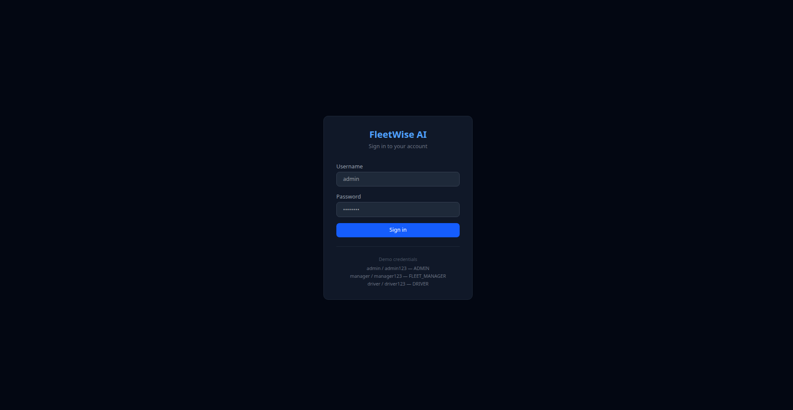
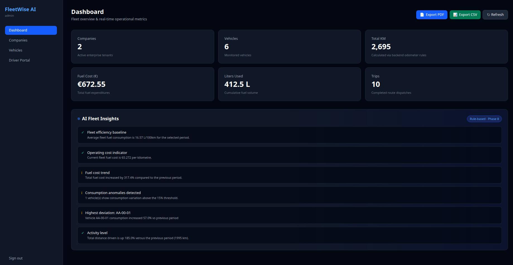
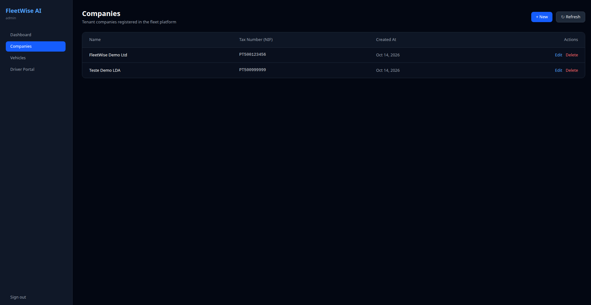
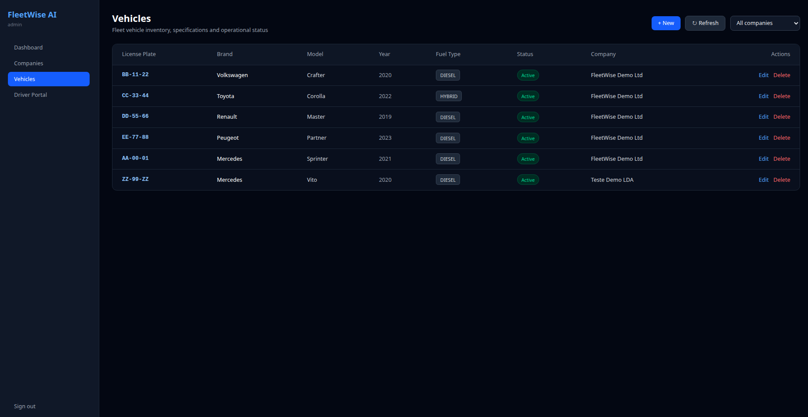
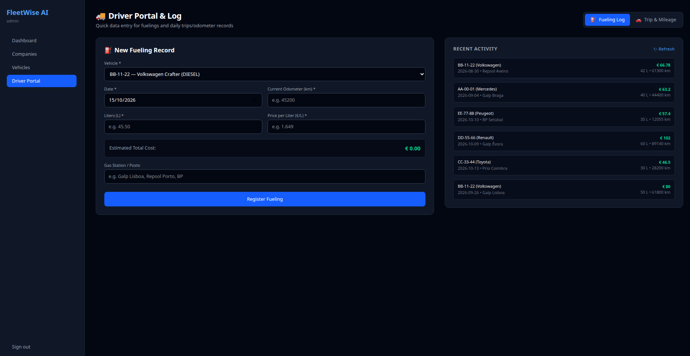
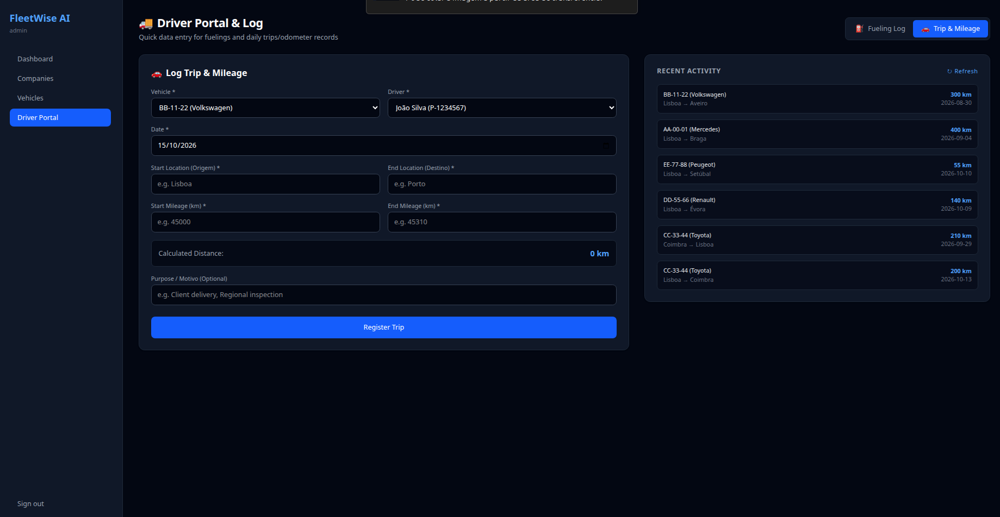
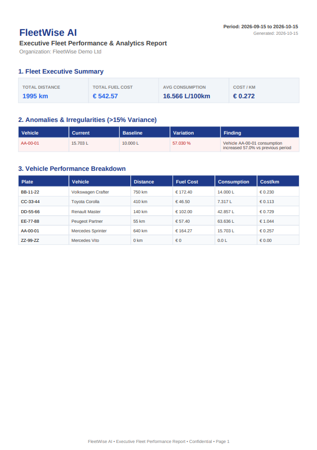

# FleetWise AI

Fleet management platform that centralises vehicle, trip, fuel and expense data and uses AI to help managers identify cost drivers and anomalies.

> Portfolio project focused on demonstrating **how AI assists software development**  
> (time savings, architecture decisions, clean domain design).


## Live demo

- **URL:** https://fleetwise-ai-production.up.railway.app
- **Demo users:**

| User    | Password    | Role          |
|---------|-------------|---------------|
| admin   | admin123    | ADMIN         |
| manager | manager123  | FLEET_MANAGER |
| driver  | driver123   | DRIVER        |

> Note: Auth, RBAC, AI insights API and demo seeds are live.

---

## Screenshots

### Login


### Dashboard


### Companies


### Vehicles


### Driver Portar for fueling


### Driver Portar for trip's


### Pdf Report example


---

## Stack

| Layer                  | Technology                                                 |
|------------------------|------------------------------------------------------------|
| Language               | Java 21                                                    |
| Framework              | Spring Boot 3.4                                            |
| API                    | Spring Web (REST)                                          |
| Persistence            | Spring Data JPA + Hibernate                                |
| Validation             | Bean Validation                                            |
| Security               | Spring Security + JWT + basic RBAC (Entra ID later)        |
| Frontend               | Angular (Standalone Components + Signals) + Tailwind CSS   |
| Database (local)       | PostgreSQL 16                                              |
| Database (prod target) | Azure SQL                                                  |
| Build                  | Maven                                                      |

## Project structure (feature / domain oriented)

```text
com.fleetwise
├── ai                  AI insights engine (Groq / gpt-oss-20b via Spring RestClient)
├── auth                JWT login, JwtService, filter, demo users
├── common
│   ├── config          SecurityConfig, DataSeeder, SpaForwardController
│   └── exception       ResourceNotFound, BusinessRule, GlobalExceptionHandler
├── company             Company domain, CRUD, repository, validation
├── vehicle             Vehicle domain, multi-company JOIN FETCH, CRUD
├── driver              Driver domain, CRUD, validation
├── trip                Trip domain, auto distance calculation, CRUD
├── fueling             Fueling domain, auto total cost calculation, CRUD
├── expense             Expense domain, CRUD
├── maintenance         Maintenance domain, CRUD
└── analytics           Fleet & vehicle telemetry, consumption, anomaly rules
```

## Key engineering decisions

1. **Distance is calculated on the backend**  
   `distance = endMileage - startMileage`. Prevents tampering and keeps the business rule in one place.

2. **Fuel total cost is calculated on the backend**  
   `totalCost = liters × pricePerLiter` (scale 2, HALF_UP).

3. **DTOs + Bean Validation**  
   Entities are never exposed. Requests are validated before reaching the service layer.

4. **RFC 7807 ProblemDetail**  
   Consistent error responses for 404, 422 (business rules) and 400 (validation).

5. **Feature packages**  
   Ready for analytics, AI and reporting without restructuring.

6. **JWT + Role-Based Access Control (RBAC)**  
   Stateless bearer-token authentication with method-level authorization (`@PreAuthorize`):  
   - `ADMIN`: Full system access across all resources.  
   - `FLEET_MANAGER`: Full operational management across fleet, vehicles, trips, and analytics.  
   - `DRIVER`: Read-only access to trips and vehicles; write access strictly restricted to fuelings (`POST /api/v1/fuelings`).  

7. **Multi-company fleet scope**  
   Vehicles always belong to a company. List API returns `companyName` and supports `?companyId=` so managers can operate across corporate groups without mixing fleets.

## API overview

| Resource | Base path | Read Access | Write Access |
|---|---|---|---|
| Auth | `/api/v1/auth/login` | Public | Public (Login) |
| Companies | `/api/v1/companies` | Authenticated | `ADMIN`, `FLEET_MANAGER` |
| Vehicles | `/api/v1/vehicles` | Authenticated | `ADMIN`, `FLEET_MANAGER` |
| Drivers | `/api/v1/drivers` | Authenticated | `ADMIN`, `FLEET_MANAGER` |
| Trips | `/api/v1/trips` | Authenticated | `ADMIN`, `FLEET_MANAGER` |
| Fuelings | `/api/v1/fuelings` | Authenticated | Create: `+ DRIVER` \| Edit/Delete: Managers only |
| Expenses | `/api/v1/expenses` | Authenticated | `ADMIN`, `FLEET_MANAGER` |
| Maintenances | `/api/v1/maintenances` | Authenticated | `ADMIN`, `FLEET_MANAGER` |
| Analytics | `/api/v1/analytics` | `ADMIN`, `FLEET_MANAGER` | `ADMIN`, `FLEET_MANAGER` |
| **AI Insights** | `/api/v1/ai` | `ADMIN`, `FLEET_MANAGER` | N/A |

All domain endpoints require a valid bearer token. List endpoints accept optional filters (`companyId`, `vehicleId`). Current login uses in-memory demo users (not production identity management).

---

## Local Development

### Prerequisites
- **Java 21**
- **Node.js 20+** & **npm**
- **Docker** & **Docker Compose**

### 1. Start the Database
```bash
docker compose up -d
```
Starts PostgreSQL 16 on `localhost:5432` (db: `fleetwise`, user: `fleetwise`, pass: `fleetwise`).

### 2. Start the Backend (Spring Boot)
```bash
./mvnw spring-boot:run
```
Runs on `http://localhost:8081`. Demo seed data is automatically populated on first run.

### 3. Start the Frontend (Angular)
```bash
cd frontend
npm install
npm start
```
Runs on `http://localhost:4200` with automated reverse-proxying of `/api` requests to port `8081`.

---

## Roadmap

| Phase | Scope                                                       | Status      |
|-------|-------------------------------------------------------------|-------------|
| 0     | Product definition                                          | Done        |
| 1     | Database + domain model                                     | **Done**    |
| 2     | Spring Boot REST API + business rules                       | **Done**    |
| 3     | Analytics (consumption, cost/km, variation, anomaly rules)  | **Done**    |
| 4     | Angular dashboard (KPIs, tables, Signals, Tailwind)         | **Done**    |
| 5     | JWT login foundation + basic RBAC; Entra ID later           | **In progress** |
| 6     | Azure / cloud deployment (Railway for public demo)          | **Done** (demo) |
| 7     | Blob Storage + document extraction                          | Planned     |
| 8     | AI assistant (insights, “why?”, natural language questions) | Done (gpt-oss-20b Integration via RestClient) |
| 9     | Anomaly detection (rules → ML)                              | Planned     |
| 10    | AI monthly reports (PDF + CSV export)                       | **Done**    |
| 11    | CI/CD (GitHub Actions)                                      | **Done**    |
| 12    | Monitoring (App Insights) + Key Vault                       | Planned     |
| 13    | Documentation                                               | Ongoing     |

---

## Development log – AI-assisted time tracking

Detailed task-by-task log available in [`AI_MIGRATION_LOG.md`](AI_MIGRATION_LOG.md).

| Phase       | Manual estimate | With AI      | Saved            | Notes                                                                                   |
| ----------- | --------------- | ------------ | ---------------- | --------------------------------------------------------------------------------------- |
| 1–2         | ~14.5–16.5 h    | ~2 h         | ~12.5–14.5 h     | Domain, CRUDs, validation, Docker                                                       |
| 3           | ~6 h            | ~1h 30min    | ~4.5–5.1 h       | Fleet/vehicle metrics & anomaly rules                                                   |
| 4           | ~13.5–14.0 h    | ~1h 15min    | ~12.2–12.7 h     | Enterprise Angular (Signals, DI, Tailwind)                                              |
| 4.9 / 5.x   | ~3.0–4.0 h      | ~1h 30m      | ~1.5–2.5 h       | Multi-company vehicle filter + Companies/Vehicles 
CRUD forms                            |
| 5 (partial) | ~8.0 h          | ~1h 30min*   | ~6.5 h*          | JWT login + basic RBAC (Entra ID still pending)                                         |
| 6 (Demo)    | ~5.0–6.0 h      | ~2h 15m      | ~3.0–3.5 h       | Railway deploy, Docker, prod JWT, SPA static files                                      |
| 8           | ~10.0 h         | ~1h 00m*     | ~9.0 h*          | Fleet Insights (GROQ / model) via Spring RestClient                                     |
| 10          | ~5.0 h          | ~45m         | ~4.2 h           | OpenPDF backend + Angular Blob 
download             |
| 11          | ~4.0 h          | ~45m         | ~3.2 h           | Backend + Frontend CI on GitHub Actions                                                 |
| **Total**   | **~69–73.5 h**  | **~12h 30m** | **~56.6–61.2 h** | Backend + Analytics + Angular + Auth + multi-company UI                                 |

Note on Time Estimates:
Manual estimates serve as a reference benchmark for unassisted development. Through an AI-assisted workflow, development speed was greatly enhanced by automating repetitive code, while my focus remained on prompt engineering, architectural consistency, and verifying feature correctness.

---

## License

MIT